# MuscleBidsTools: code map (who calls what, and why)

A picture of the code in [MuscleBidsTools.wl](../QMRITools/Kernel/MuscleBidsTools.wl), for developers. The text version,
with line numbers, config keys and quirks, is [MuscleBidsTools.md](MuscleBidsTools.md). How to run the pipeline is in
the manual [BIDS-config.md](../QMRITools/BIDS%20Example/BIDS-config.md).

- Arrows mean "calls". Blue boxes are public functions, white boxes are private, grey boxes are other toolboxes.
- The edges come from `agents/callgraph` (regenerated 2026-11-18). To check one function:
  `wolframscript -file agents/callgraph.wls callers <name> 2` (or `callees`).

---

## 1. The five layers

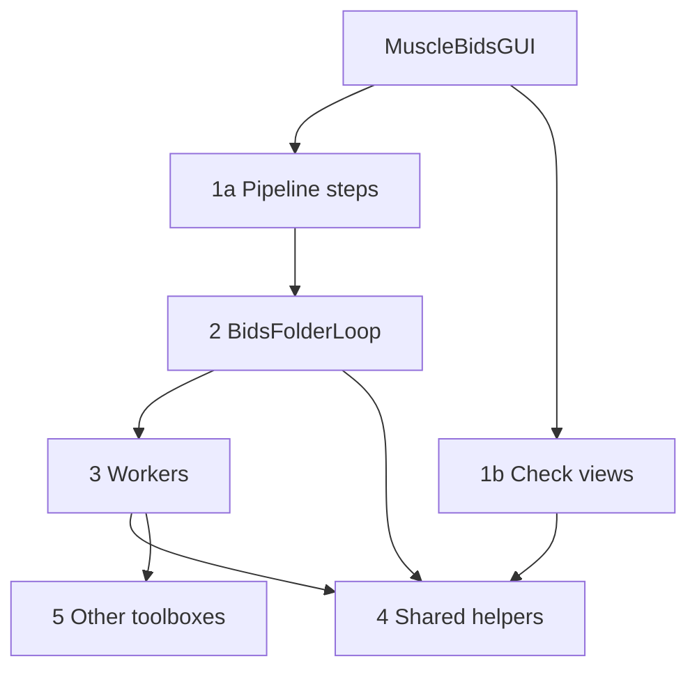

| Layer | Functions |
| --- | --- |
| 1a Pipeline steps | `BidsDcmToNii`, `MuscleBidsConvert`, `MuscleBidsProcess`, `MuscleBidsMerge`, `MuscleBidsSegment`, `MuscleBidsTractography`, `MuscleBidsAnalysis` |
| 1b Check views | `MuscleBidsConfig`, `MuscleBidsCheck`, `MuscleBidsReport`, `MuscleBidsSummary`, `CheckBidsSubjects` (section 5) |
| 2 Driver | `BidsFolderLoop` (section 2) |
| 3 Workers | `BidsDcmToNiiI`, `MuscleBidsConvertI`, `MuscleBidsProcessI`, `MuscleBidsMergeI`, `MuscleBidsSegmentI`, `MuscleBidsTractographyI`, `MuscleBidsAnalysisI` (section 4) |
| 4 Shared helpers | config: `GetConfig`, `ConfigLookup`, `MergeConfig`, `CheckConfig`, `CheckDataDescription`; names: `GenerateBidsName`, `GenerateBidsFileName`, `PartitionBidsName`, `BuildBidsNameFromConfig`, `SelectBids`; json: `ImportJSON`, `GetJSONPosition`, `MergeJSON`, `SourceJSON`, `OptionsToJSON` (section 3) |
| 5 Other toolboxes | NiftiTools, LoggingTools, DixonTools, TensorTools, IVIMTools, DenoiseTools, ElastixTools, RelaxometryTools, SegmentationTools, TractographyTools, MaskingTools, ProcessingTools, PlottingTools |

Why it is built this way:

- **One driver for seven steps.** Subject selection, per-subject config, logging and error handling are written once
  in `BidsFolderLoop`. A worker only has to process one dataset of one subject.
- **Steps talk through files only.** A worker never returns data to the next step. It writes files, and the next
  worker rebuilds the same file names with the layer 4 name functions. This makes every step restartable on its own.
- **The check views reuse the workers' name logic.** They predict which files and check files a step should have
  written, so they need the same name functions. That is the main coupling in the file (section 6).

---

## 2. Layer 1 → 3: one step, from call to worker

Every step has the same three overloads. `MuscleBidsProcess` as the example:

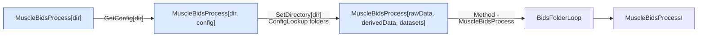

- `[dir]` is what users call. `[dir, config]` lets a script pass an edited config without writing it to disk.
  `[in, out, datasets]` is the folder form that the loop needs.
- `BidsDcmToNii` passes `config["conversion"]` instead of `datasets`, `MuscleBidsAnalysis` passes `config["analysis"]`
  and after the loop joins all subject tables into `All_<date>.xlsx`.

### Inside `BidsFolderLoop`

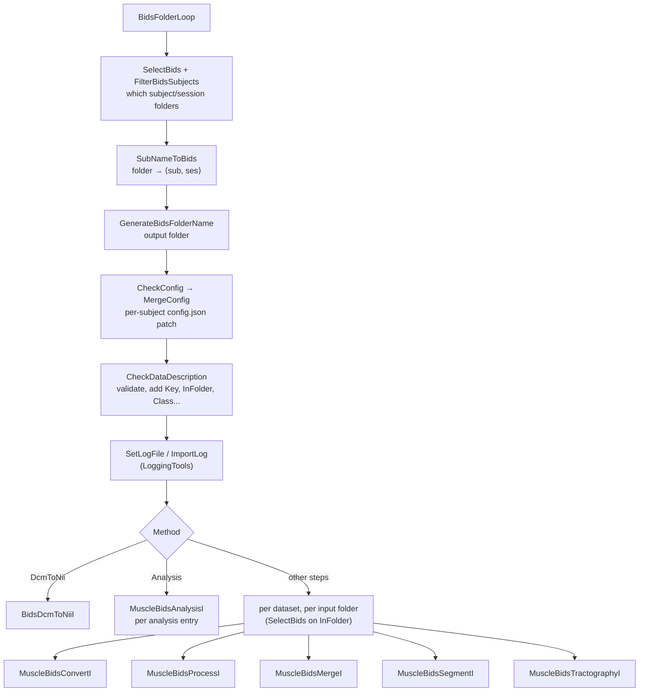

- `CheckDataDescription` runs per subject, after the custom config is merged, so a subject can change a dataset's
  settings. It also adds the fields the workers rely on (`Key`, `HasDuplicate`, `InFolder`, `OutFolder`, `Class`). A
  dataset that fails validation gets a `$Failed` key and is logged and skipped by the loop.
- Merge, Segment and Tractography workers get the **whole** dataset list (`{type, datDis}`), because their `Target`
  can point at another dataset (for example DTI registered to Dixon).

---

## 3. Layer 4: the shared helpers

### Names: the link between steps

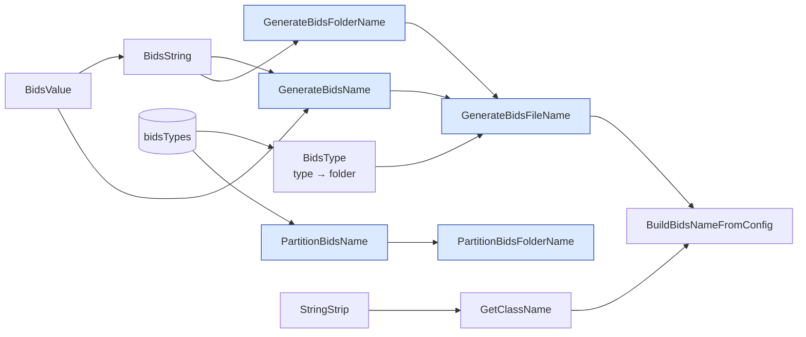

| Function | Does | Used by |
| --- | --- | --- |
| `GenerateBidsName` | `⟨sub, ses, stk, type, suf⟩` → `sub-1_ses-1_stk-A_megre_dix` | everything that writes or looks for a file |
| `GenerateBidsFileName` | the same plus the folder `root/sub/ses/<typefolder>/` | all workers, `BidsCheckFiles` |
| `PartitionBidsName` / `PartitionBidsFolderName` | the inverse: name or path → parts | workers (to rebuild sub/ses from the input folder), `SubNameToBids` |
| `BuildBidsNameFromConfig` | a config `Target`/`Moving` list → the file name the previous step wrote | Merge, Segment, Tractography workers, `BidsCheckFiles` |
| `SelectBids`, `FilterBidsSubjects`, `SubNameToBids` | find `sub-*/ses-*/<folder>` and apply `ProcessSubjects` | loop, `BidsSubjectList`, `GetProtocolNames`, GUI |

### Config

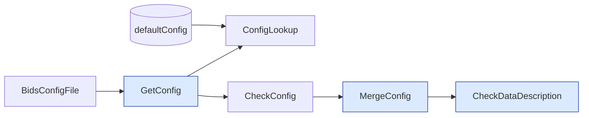

- `ConfigLookup[config, group, key]` is the only place where defaults are filled in. Every worker reads its settings
  through it, so a new config key needs only a `defaultConfig` entry and a `ConfigLookup` call.
- `CheckConfig[fol, out]` finds the per-subject `config.json` and copies it to the output folder, so the next step
  sees the same patch.

### json (provenance)

| Function | Does | Used by |
| --- | --- | --- |
| `ImportJSON` | fast json read with a fallback | everywhere |
| `GetJSONPosition` | select the files whose json matches `{key, value}` rules | Convert |
| `MergeJSON` | source json + step settings → output json | Convert, Process, Merge, Segment, Tractography |
| `SourceJSON` | the json that belongs to a data file | Segment, Tractography, Analysis |
| `OptionsToJSON` → `JSONSafe` | fit options → json-safe values, the same list is used for the call and the json | Process, Merge, Segment, Tractography |

---

## 4. Layer 3 → 5: what each worker uses

### Step 1 and 2: conversion

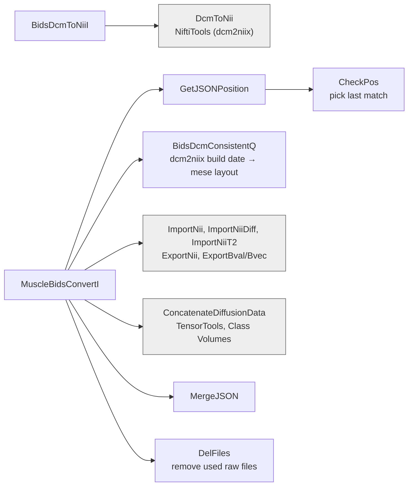

### Step 3: `MuscleBidsProcessI`, one branch per data type

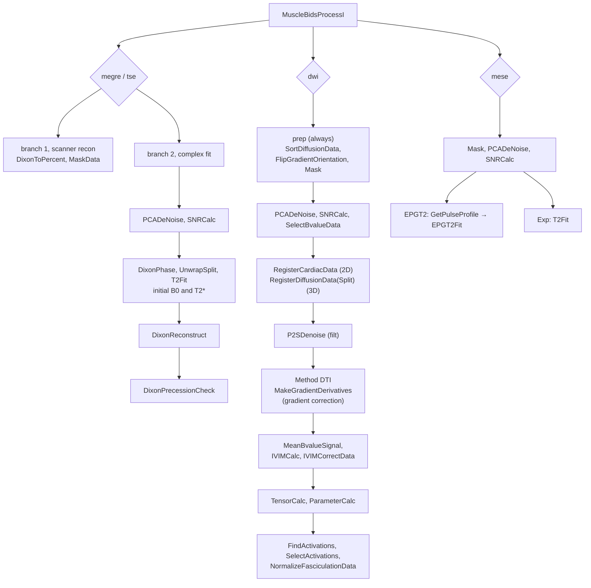

- The two Dixon branches are gated `If`s, not a `Switch`. `Dixon-A` runs both: branch 2 overwrites branch 1 when raw
  complex data exists, and each branch does nothing when its files are missing. This is on purpose (CodeStyle.md).
- dwi prep and fit have their own check files (`_prep` and the main one), so a new `Method` reruns the fit without
  redoing the slow denoise and registration.
- Outputs are written by name: a local variable called `fa` is exported as `<set>_fa.nii`. To add an output, add a
  variable with that name and add the name to `outTypes`.

### Step 4: `MuscleBidsMergeI`

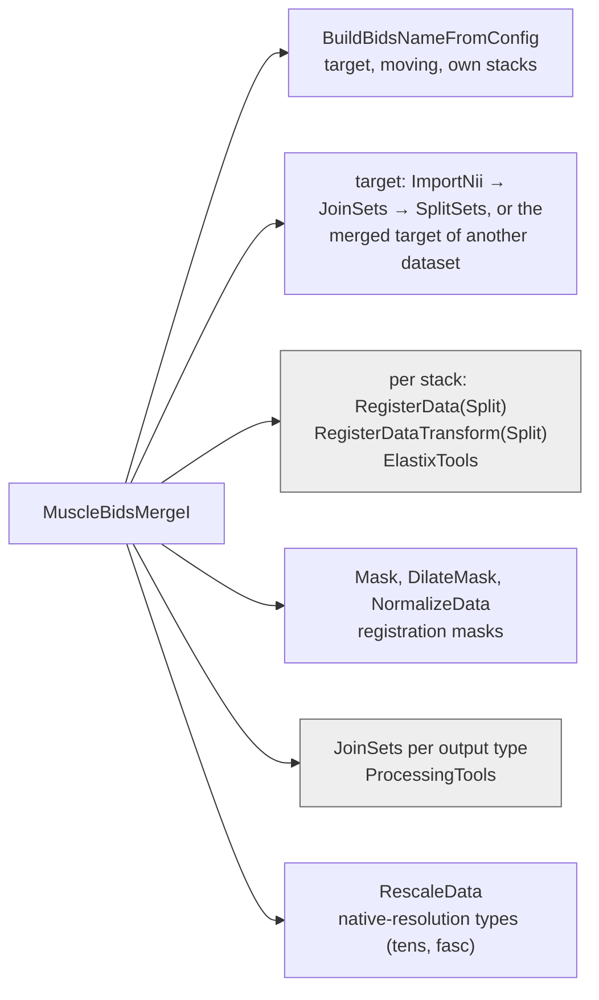

- The target is joined and split again so that the moving stacks are registered stack by stack to the matching part
  of the target. Registering whole volumes would mix the motion of different stacks.
- The registration type follows the input folder: `dix` rigid, `quant` rigid + affine, `dwi` adds a bspline.

### Step 5 and 6: segmentation and tractography

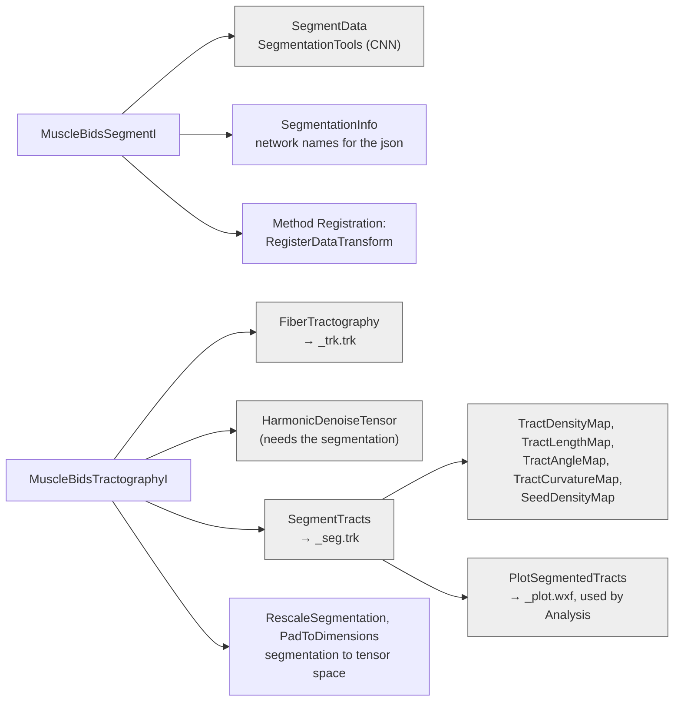

- Tractography keeps its state in one check file: none → `track` → `seg` → `done`. `BidsTractographyMethod` picks which
  part runs, so the slow tracking does not rerun when only the segmentation changed.

### Step 7: `MuscleBidsAnalysisI`

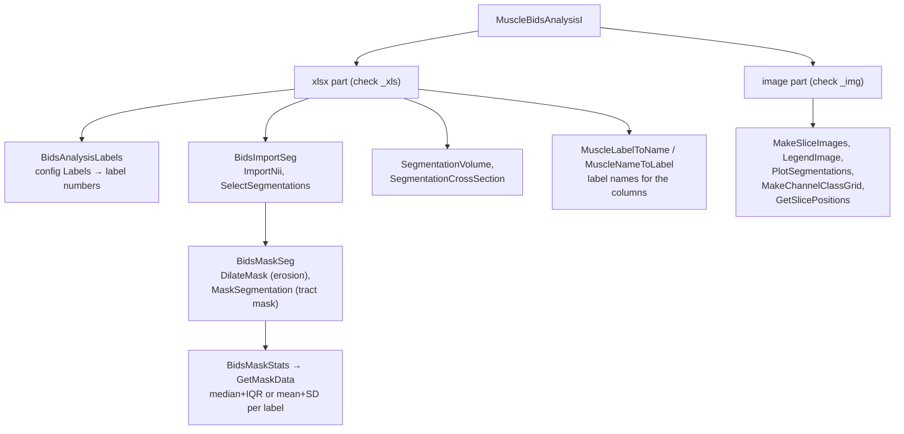

- The default segmentation and every `TypeSegmentation` go through the same `BidsImportSeg` → `BidsMaskSeg` path, so
  erosion and tract masks are applied the same way everywhere.

---

## 5. The tools around the pipeline

These read the config and the output folders and change nothing (except `ManageCheckFiles`, which deletes check files).

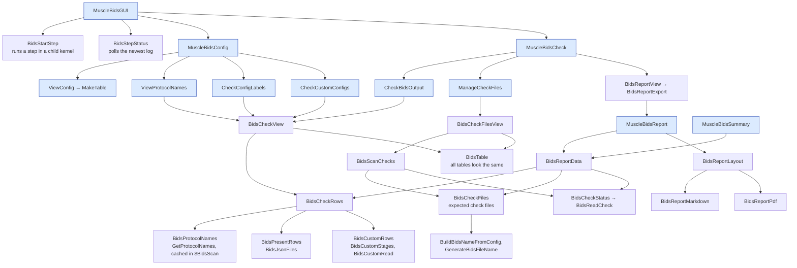

Why it is built this way:

- **Rows, then tables.** `BidsCheckRows` makes rows `{cells, bad}` for every table check, `BidsTable` draws them. The
  report uses the same rows, so the report and the views can never disagree.
- **Data, layout, render.** `BidsReportData` collects the problems, `BidsReportLayout` orders them without a format,
  and the md and pdf renderers only draw. A new format is a new renderer.
- **Scan first, then draw.** The views scan in a `With` before the `DynamicModule`. Scanning inside a `Dynamic` hits
  the 5 s front-end limit. In the GUI the tabs start lazy (`$BidsLazy`) and scan on Reload.
- **Child kernel for steps.** `BidsStartStep` runs a step over a link, so the GUI stays usable and a crash does not
  take down the notebook kernel. Step names go over the link as strings because the child loads the package later.

---

## 6. Couplings: change one, check the other

| If you change | Also change or check | Why |
| --- | --- | --- |
| a file name a worker writes | every later worker that reads it, `BidsCheckFiles`, `BuildBidsNameFromConfig` | steps find their input by rebuilding names |
| a worker's check-file name or the condition for writing it | `BidsCheckFiles` | it predicts the check files with the same calls |
| a config key or default | `defaultConfig`, the manual BIDS-config.md, `ViewConfig` shows it automatically | `ConfigLookup` is the only reader |
| the json glob of Process (`BidsJsonFiles`) | `CheckBidsOutput` Convert rows | both use `BidsJsonFiles`, Convert has its own glob |
| the classes of a problem (error, missing, ...) | `BidsCheckClass` | the Check tab and the report share it |
| an option of a step | `BidsFolderLoop` options, `MuscleBidsGUI` controls, `BidsStartStep` | options pass through the loop and over the link |
| a fit option list (`denOpts`, `dixOpts`, ...) | nothing | the same list is used for the call and the json |
